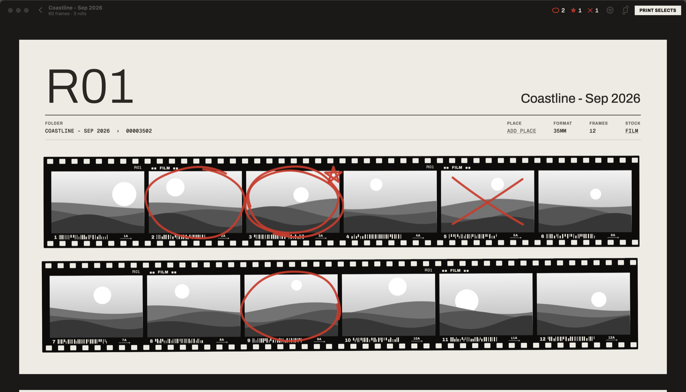

# CONTACT

Cull a shoot on a darkroom contact sheet before anything goes into Lightroom. See [SPEC.md](SPEC.md) for the full design.



## Build and run

```bash
./scripts/build-app.sh                 # → build/Contact.app (Command Line Tools only, no Xcode)
./scripts/install-app.sh               # builds, then installs /Applications/Contact.app
open "build/Contact.app"
```

Copy it to /Applications to keep it in the Dock. `swift run ProofPositive "<shoot folder>"` also works for quick iteration.

Ratings need exiftool (`brew install exiftool`; it's already at /usr/local/bin on this Mac).

## Using it

1. Open a shoot folder: ⌘O, drag it onto the window or Dock icon, or pick it from Recent.
2. Mark frames: hover a frame (or move with the arrows) and press `S` select / `F` star / `X` reject / `⌫` clear. Clicking never marks.
   Hold `Space` for the loupe; `Return` or double-click for full screen; ‹ (or `Esc`) goes back a level.
3. ⌘R reprints only circled frames for a second pass.
4. ⌘P **Print Selects** moves ◯/★ into `Selects/`, ✕ into `reject/`, and writes 5★/3★ ratings. ⌥⌘Z undoes it.
5. In Lightroom, import `<shoot>/Selects` (Add, include subfolders).

## Checks

```bash
swift run ProofChecks                          # core logic against a temp folder
swift run ProofChecks --scan "<shoot folder>"  # read-only: how a real shoot lays out into rolls
```

The app also has a scripted self-check (`PROOF_SELFCHECK`, see `Sources/ProofPositive/SelfCheck.swift`) that drives the UI and snapshots its own window.
